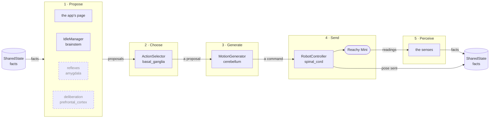

# Architecture

Why the code is organized the way it is. To go further:

- to install or run the app, see the [README](./README.md);
- to write a move, see [moves/README.md](./reachy_alive/moves/README.md);
- to write a sense detector, see
  [sensory_cortex/README.md](./reachy_alive/brain/sensory_cortex/README.md).

## The idea

A creature doesn't run one program. It breathes without thinking, flinches
before it understands, and sometimes stops to consider. Reachy Alive is
built the same way, as layers that share one body:

- **automatic**: breathing and idle moves, always running;
- **reflexes**: fast, local reactions that fire in milliseconds;
- **deliberation**: slow, considered responses that can take seconds.

One constraint shapes everything: **the robot must keep moving while it
thinks.** A cloud LLM call takes 1 to 3 seconds; written naively, the robot
would freeze and look dead, the exact opposite of the point. So the layers
never wait on each other, and none of them can stall the loop that moves the
robot.

## The map

The robot runs in a loop, 50 times a second. Each pass is a **tick**. What
the robot knows, about itself and the world, is kept as **facts** in
`SharedState`: a face in view, when the last move ended.

Read the map from left to right, like one tick:

1. the decision-makers read the facts and **propose** what to do;
2. the selector **chooses** one proposal;
3. the generator **generates** this tick's command from it;
4. the controller **sends** the command to the robot;
5. the senses **perceive** what happened, and write new facts.

`SharedState` is drawn twice, but it is one: read on the left, written on
the right, read again on the next tick. The dashed boxes come later (see
[Where it's going](#where-its-going)).



## 1 · Propose

A **decision-maker** says what the robot should do. It never drives the
robot.

Each one builds a **`Proposal`**: a move to start, a direction to look at,
or both. A proposal is an order for one tick: it is passed on, never stored.

There are two today:

- **`IdleManager`** (`brain/brainstem/`): once the robot has rested for a
  while, it proposes an idle move, such as a yawn. The delay is drawn from
  the interval kept in `SharedState`.
- **The app's page**: it proposes the move someone clicked. Its routes
  (`routes.py`) run in the web server's own thread: they put the proposal in
  a queue and answer at once. They also change the settings in
  `SharedState`, such as the idle move interval or a sense switched off.

Reflexes and deliberation will propose the same way.

## 2 · Choose

The **`ActionSelector`** (`brain/basal_ganglia/`) picks one proposal per
tick, or none:

- while the `MotionGenerator` is busy, with a move or its way back to
  neutral, it picks nothing;
- otherwise, it picks by priority: the page first, then `IdleManager`.
  Reflexes will come first.

It only chooses: it never builds a pose. To choose, it asks the generator
two questions: is it busy, and how long has the robot been resting, which
`IdleManager` needs.

## 3 · Generate

The **`MotionGenerator`** (`brain/cerebellum/`) turns the proposal chosen
into one command per tick: a pose, and the sounds due. It never sends
anything to the robot.

- **A move:** it cuts it into poses, one per tick, then eases back to
  neutral from the last pose sent.
- **Nothing to play:** the robot breathes.
- **A direction:** the head turns there, easing in and out. A small turn
  moves the head alone; a large one brings the body along, more slowly, so
  the head leads.

It keeps what plays and since when, and where the head and the body point.
A move is written facing the front; the generator turns every pose toward
where the robot looks. Nothing proposes a direction yet, so the robot faces
the front.

## 4 · Send

The **`RobotController`** (`spinal_cord/`) runs the loop, in its own
thread. On every tick, it:

1. asks the `ActionSelector` for a proposal;
2. hands it to the `MotionGenerator`, which returns this tick's command;
3. sends the pose to the robot, and the sounds to the `SoundPlayer`;
4. records the pose sent in `SharedState`: the **efference copy**.

It is the only part that drives the robot, and it never waits. Starting a
sound takes the robot 20 to 85 ms, so the `SoundPlayer` does it in its own
thread. The controller also records in `SharedState` when a move plays and
when it ends: the senses read it.

## 4 · Perceive

Four senses run beside the loop, each in its own thread, started by
`SenseManager`: the inertial unit, touch (the antennas), hearing and vision.
Each reading of a sensor is described by its features, which the sense's
detectors turn into facts in `SharedState`: a bump, an antenna pushed, a
sudden noise, a face in view.

While a move plays, and just after, the robot perceives itself: its motors
shake the head and make noise. The detectors know it from the efference
copy, and record nothing then. The app's page shows the facts, and can
switch a sense off. Nothing reacts to them yet.

How a sense, its features and its detectors fit together is drawn in
[sensory_cortex/README.md](./reachy_alive/brain/sensory_cortex/README.md).

## SharedState

The facts any module may read at any time, each written by one module only:

- whether a move is playing, and when the last one ended: the
  `RobotController`;
- what the senses perceived: their detectors;
- the settings, such as the idle move interval and the senses switched
  off: the app's routes.

Orders never go there: a proposal travels as a command, executed once (see
rule 4).

## Two ticks through the loop

### Breathing, then an idle move

On most ticks, nobody proposes a move: the `MotionGenerator` returns the next
breathing pose, and the `RobotController` sends it to the robot. On
the next tick, the next pose.

Meanwhile, `IdleManager` has drawn a delay from the interval kept in
`SharedState` (20 to 30 s by default, adjustable from the app's page), and
picks a move when it is due, say a yawn. Its sounds are already on the
robot: the app uploads every move's sounds once, when it starts. Once the
robot has been resting for that delay, as the `MotionGenerator` counts it, it
proposes the yawn.

The `ActionSelector` chooses the yawn, and the `MotionGenerator` cuts it into
ticks: each one carries its pose and the sounds due then, and the
`RobotController` sends it. Half a second of
way back to neutral follows, cut the same way. Then breathing resumes from
neutral, and the robot's rest starts again from zero.

### Someone clicks "Sneezing"

- The page sends `POST /moves/sneezing/play`. The web server runs in its own
  thread: the route checks the name, drops the move in a queue, and answers
  at once. It never touches the robot.
- On the next tick, the `ActionSelector` finds the request and chooses the
  sneeze; the `MotionGenerator` cuts it into ticks. Breathing will start again from neutral
  after it.
- If several clicks arrive during one move, only the latest plays.
- From there, it goes like an idle move: played, its end recorded, then
  breathing again.

### What never happens

Nothing calls a move directly, and no thread but the loop's drives the
robot. Sources only propose; one component chooses; one executes. That is
what lets reflexes and deliberation join later without touching the rest.

## Vocabulary

- **Tick**: one pass of the control loop, 50 per second.
- **Move**: one discrete thing the robot does, from start to finish: a yawn,
  a sneeze, a hiccup. In code, a `Move`, written as a `PhasedMove` or wrapped
  from a recording as a `LibraryMove`.
- **Idle move**: a move `IdleManager` picks on its own, between breaths.
- **Breathing**: the continuous motion between moves. It is not a move: it
  never ends.
- **Decision-maker**: a module that proposes what the robot should do.
  Today, `IdleManager`; later, reflexes and deliberation. The app's page
  proposes too, through its routes.
- **Command**: an order for one tick, handed to the `RobotController` and
  executed once: hold this pose, or play this move.
- **`SharedState`**: the facts any module may read at any time, such as
  when the last move ended. Orders never go there.
- **Efference copy**: what the robot is doing itself, kept as a fact so the
  senses can tell its own motion and sounds from the world's. Today: whether
  a move is playing, waking up included.
- **Sense**: reads one of the robot's sensors in its own thread, and
  describes each reading by its **features**, such as how loud a frame of
  sound is. It never says what they mean, and never drives the robot.
- **Detector**: reads the features of one sense, and records what they mean
  as a fact in `SharedState`, such as a sudden noise.
- **The app's page**: the web page the app serves. It shows up next to
  Reachy Mini Control while the app runs, or at `http://localhost:8042`.

## Code map

```
reachy_alive/
├── main.py               Builds every part and wires them together; lists the idle moves.
├── shared_state.py       Facts shared across threads: whether a move is playing, the senses' facts, the settings.
├── routes.py             HTTP routes behind the app's page: moves, settings, and what the senses perceive.
├── spinal_cord/          From a chosen move to the robot: commands, the RobotController and its SoundPlayer.
├── brain/                The brain regions, sorted by speed (see rule 8).
│   ├── basal_ganglia/    Choosing: the ActionSelector picks what the robot does, by priority.
│   ├── brainstem/        Automatic behavior: breathing, and IdleManager.
│   ├── cerebellum/       Playing: the MotionGenerator cuts the move chosen into poses, breathes in between, and turns head and body.
│   └── sensory_cortex/   The senses and their detectors: sensor readings into facts. Its README: how to add a detector.
├── moves/                The Move contract (base.py), the coded moves, and the guides to write one.
├── static/               The app's page: HTML, JavaScript, CSS.
├── assets/sounds/        Move sounds, next to the presets that made them.
└── scripts/              Developer tools, such as try-move.
tests/                    Mirrors the package. Runs without a robot, on every pull request.
```

Each package's `__init__.py` says, in a few lines, what the package is for.

## Rules

**1. The control loop never blocks.** Anything slow runs outside it: the web
server has its own thread, sounds start from the `SoundPlayer`'s, and
deliberation will be asynchronous. The loop
keeps moving the robot while the rest thinks.

**2. One component executes.** Only the `RobotController` drives the robot,
from the loop's thread; its `SoundPlayer` only starts the sounds it is handed. Moves only describe themselves. Reading a sensor isn't driving: the senses
read the robot from their own threads.

**3. One component chooses.** Decision-makers only propose; the
`ActionSelector` alone decides what runs each tick. When one proposal wins
over another, the loser isn't consulted, only told.

**4. Facts go in `SharedState`, orders travel as commands.** A fact stays
readable by anyone, at any time; an order is executed once. Every field of
`SharedState` has one owning module that writes it; the others only read.

**5. Moves describe; they don't drive.** A move written in code computes its
pose from the time elapsed, and the loop sends it. Rhythms are in seconds,
never in ticks, so a move doesn't depend on how fast the loop runs.

**6. Moves are registered by hand, in `main.py`; detectors are found in
their sense's folder.** A move drives the robot: each line in `main.py` is
a move someone reviewed. What review can't catch by eye, tests do:
`test_pose_contract.py` samples every coded move and fails on a pose that
breaks the contract or sends the head out of reach. A detector only records
facts, so adding one is adding its `*_detector.py` file: nothing else to
touch.

**7. Dependencies are explicit, never global.** Anything with a side effect
when built, such as downloading a move library, is built in `main.py` and
passed down. A plain import never downloads anything, not even during tests.

**8. Folders named after brain regions, under `brain/`, hold the cognitive
modules, sorted by speed.** Fast, local and synchronous goes to `amygdala/`; slow, remote and
asynchronous goes to `prefrontal_cortex/`. Reacting to a face can mean
both: a startle belongs in the first, a greeting in the second. Sorting by
speed rather than by topic keeps anything that can block out of the fast
path, as the brain does. What carries the orders to the robot lives in
`spinal_cord/`, at the package root, outside the brain, as in a body. What
no organ does (`shared_state.py`, `routes.py`) takes plain names: the
metaphor is kept for what has a biological sense.

## Where it's going

The dashed boxes of [the map](#the-map) are what comes next.

**Done: v1.** The decision/execution split: decision-makers propose, the
`ActionSelector` chooses, the `RobotController` executes. Idle moves of all
three kinds (coded, recorded in Marionette, mixed), a stable Move contract,
contributor guides, CI. The app's page plays any move on demand and sets the
idle move interval. The app is published on its Hugging Face Space and in
Reachy Mini Control's app store.

**Done: senses.** `sensory_cortex/` gives the robot four senses (inertial
unit, touch, hearing, vision), whose detectors record timestamped facts in
`SharedState`: a bump, an antenna pushed, a sudden noise, a face in view.
Nothing reacts yet: the robot still just breathes, and the app's page shows
what it perceives, with a switch for each sense. Each fact is there for a
reaction planned below; raw signal (images, sound) stays inside its sense.

**Done: an interruptible body.** Moves run tick by tick: the
`MotionGenerator` cuts each one into a pose per tick, and could stop it on any
tick. Sounds start from their own thread, so the control loop never waits.
Nothing new shows: the robot behaves as before, with fewer freezes.

**Next: reflexes.** `amygdala/`: fast, local reactions to the senses' facts,
which interrupt whatever the robot is doing. The `ActionSelector` puts
reflexes first. Innate triggers only, two of them to start. The milestone
the project is built for: the robot perceives and reacts, without waiting
on anything slow. It starts with a direction to face: every move, and
breathing, played toward it; the head gets there first, the body after,
slower. Reflexes decide where to look; the `MotionGenerator` turns the robot
there smoothly.

**Then: deliberation.** `prefrontal_cortex/`: an asynchronous cloud LLM
call, with a timeout and a fallback. This is what decides to *look at*
someone, rather than reflexively glance.

**Then: arbitration.** Three decision-makers competing for one body: the
`ActionSelector` becomes a behavior tree.

**Later: memory.** `hippocampus/`: the cortex writes what it judged, the
amygdala reads it back in milliseconds. The robot's fast reaction becomes
right because it was slow once.
