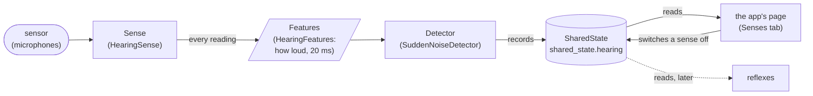

# The sensory cortex

How the robot perceives: four senses read the sensors, and detectors turn
what they read into facts the rest of the brain can use. The first part of
this page shows how it works; the second, how to add a detector.

## How the senses work



Four words, from the sensor to the rest of the brain:

- A **sense** reads one sensor: the microphones, the camera, the inertial
  unit, the antennas. It only describes what it reads, never what it means.
- Its **features** are that description, for one reading: how loud a 20 ms
  frame of sound is, where the faces are. They go from hand to hand and
  are never stored.
- A **detector** reads the features of one sense and decides what they
  mean: a sudden noise, a bump. A sense can have several detectors; a
  detector reads one sense.
- A **fact** is what a detector records in `SharedState`: when the last
  sudden noise started, whether an antenna is pushed. Anyone can read it:
  the app's page today, the reflexes later.

The senses are fixed by the robot's hardware: there are four. Detectors
are open: anything you can tell from the features can become one.

# Making a detector

A detector is all you write: reading the sensors, timing each reading,
knowing when the robot is moving itself, switching a sense off from the
page are already handled. Step 1 sends you to the page of the sense you
build on.

## What the robot does with your detector

Each sense reads its sensor in its own thread and describes every reading
by its **features**: how loud a 20 ms frame of sound is, where the faces
are. The robot finds every `*_detector.py` file in a sense's folder, builds
the detector it holds, and hands it the features of every reading:

1. to `_detect`, the method you write, while the robot is still;
2. to `_while_robot_moves` while it plays a move, or has just ended one: the
   robot then perceives itself. By default, those readings are ignored;
3. while the page has the sense switched off, it calls your `forget`
   instead.

So you never read a sensor, start a thread or register anything: drop the
file in the right folder.

## Step 1 — Pick the sense

| Sense | Its page | Its features | A detector to copy |
|---|---|---|---|
| Inertial unit | [`inertial/README.md`](inertial/README.md) | `InertialFeatures` | `bump_detector.py` (the simplest) |
| Touch | [`touch/README.md`](touch/README.md) | `TouchFeatures` | `antenna_push_detector.py` |
| Hearing | [`hearing/README.md`](hearing/README.md) | `HearingFeatures` | `sudden_noise_detector.py` |
| Vision | [`vision/README.md`](vision/README.md) | `VisionFeatures` | `face_presence_detector.py` |

Each page says what the sense gives and what to watch out for. The fields
of the features are described in the sense's `*_features.py`.

## Step 2 — Name the fact

A detector says what happened; it never makes the robot do anything. What
it finds goes into `SharedState`, where the rest of the brain reads it.
Each sense has its facts there: `shared_state.hearing` holds `HearingFacts`,
in `reachy_alive/shared_state.py`.

Add your fact to its sense's facts: a `record_…` method your detector
calls, and a method that reads it back. Your detector is the fact's only
writer: say so in a comment above the methods, as the others do.

## Step 3 — Write the detector

`bump_detector.py` is the reference: copy its shape.

```python
from reachy_alive.brain.sensory_cortex.detector import Detector
from reachy_alive.brain.sensory_cortex.inertial.inertial_features import InertialFeatures
from reachy_alive.shared_state import InertialFacts


class YourDetector(Detector):
    """Spots …"""

    THRESHOLD = 2.5  # your settings, as class constants

    def __init__(self, facts: InertialFacts) -> None:
        super().__init__(facts)
        self.forget()

    def forget(self) -> None:
        """Forget what is going on. Past events stay: they still happened."""
        ...

    def _detect(self, features: InertialFeatures) -> None:
        """Record your fact if this reading shows it."""
        ...

    def _while_robot_moves(self, features: InertialFeatures) -> None:
        """Optional. The robot perceives itself now: ignored by default.

        Override it only to keep something up to date, such as a background
        level, never to record facts.
        """
```

`__init__` calls `forget()`: a new detector is one that just forgot, so the
starting state is written once.

## Step 4 — Try it

```bash
uv run pytest                        # checks the logic, no robot needed
uv run python reachy_alive/main.py   # the whole app, on a robot
```

Trying a detector on the robot means making it happen, again and again:
clap after clap, bump after bump. A test is faster: build the features by
hand, feed them to `update()`, and check what your fact received. It runs
in a second, without the robot, and gives the same answer every time.

```python
from unittest.mock import MagicMock

from reachy_alive.brain.sensory_cortex.inertial.bump_detector import BumpDetector
from reachy_alive.brain.sensory_cortex.inertial.inertial_features import InertialFeatures
from reachy_alive.shared_state import InertialFacts


def test_a_knock_is_a_bump():
    facts = MagicMock(spec=InertialFacts)
    detector = BumpDetector(facts)
    knock = InertialFeatures(
        perceived_at=1.0, accelerometer=(0.0, 0.0, 14.0), robot_moving_itself=False
    )
    detector.update(knock)
    facts.record_bump.assert_called_once_with(1.0)
```

`tests/brain/sensory_cortex/` has a test file for each detector to copy
from. A test isn't required in your pull request, but it is the quickest
way to tune your thresholds.

Then run the app: at startup, the logs list each sense's detectors. Check
yours is there.

## Things that will bite you

**Date facts with `features.perceived_at`, never `time.monotonic()`.** A
reading can reach your detector late; the time it was perceived is the
truth.

**`forget()` clears what is going on, not what happened.** An antenna
pushed is no longer known once touch is switched off; the last bump still
happened.

**The robot perceives itself.** Its moves shake the inertial unit, move
the antennas and the camera, and it hears its own motors: that is why
those readings go to `_while_robot_moves`, not `_detect`.
